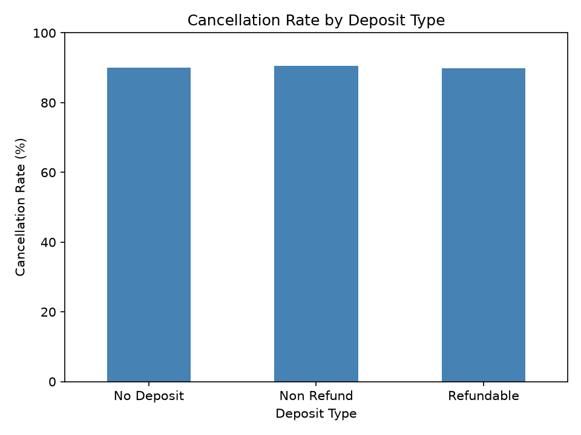
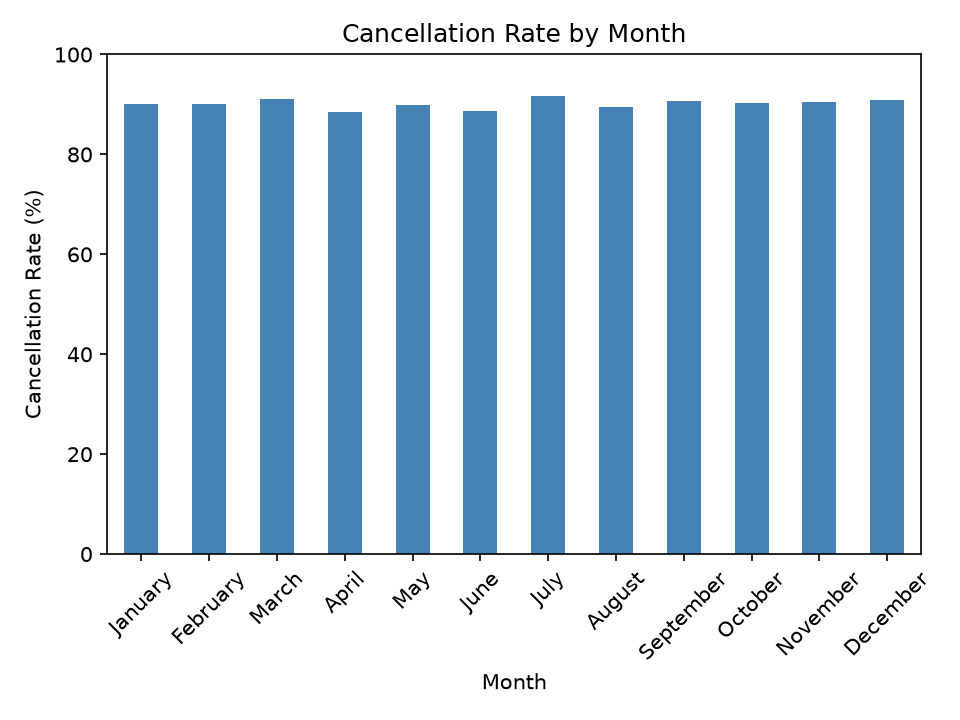
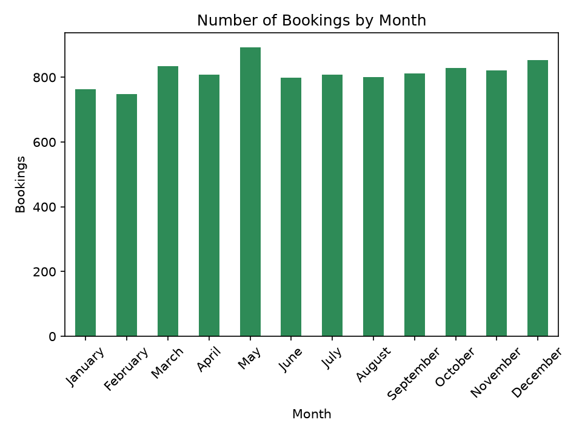
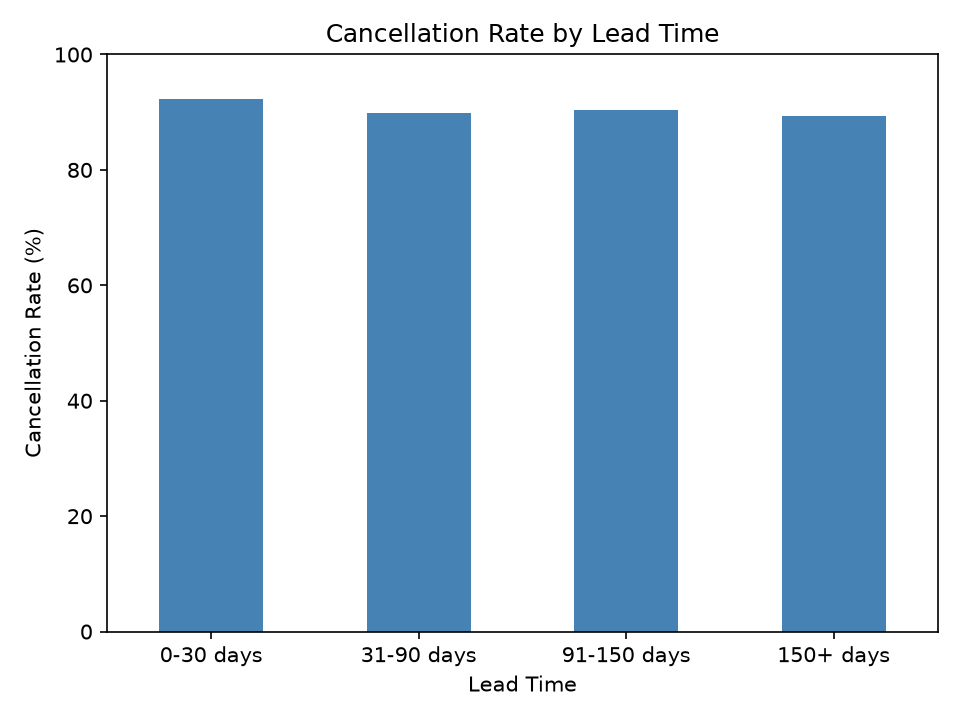
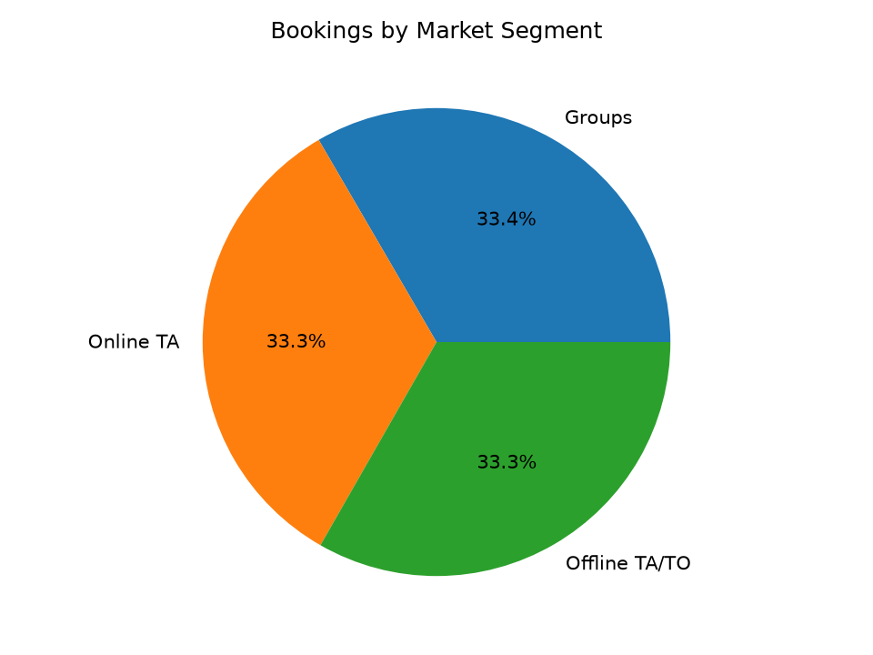
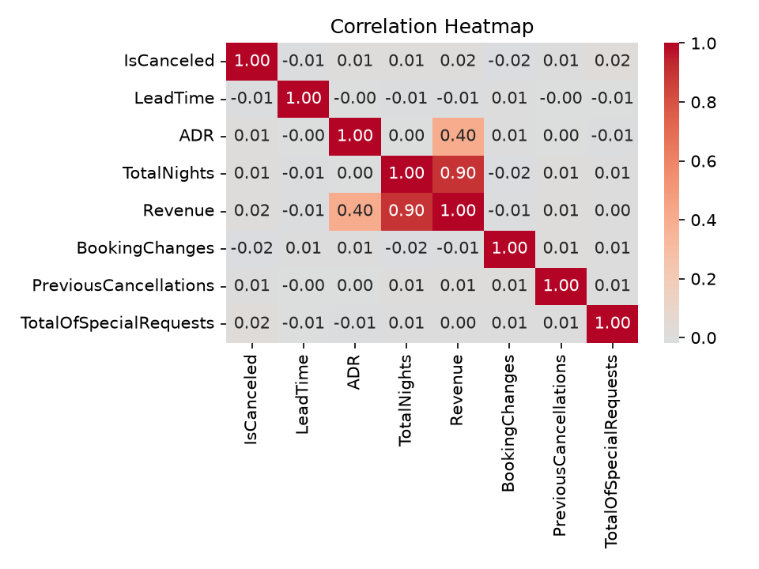
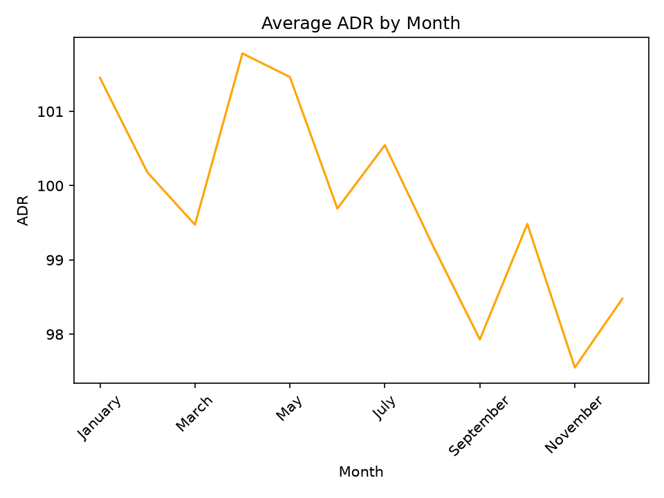
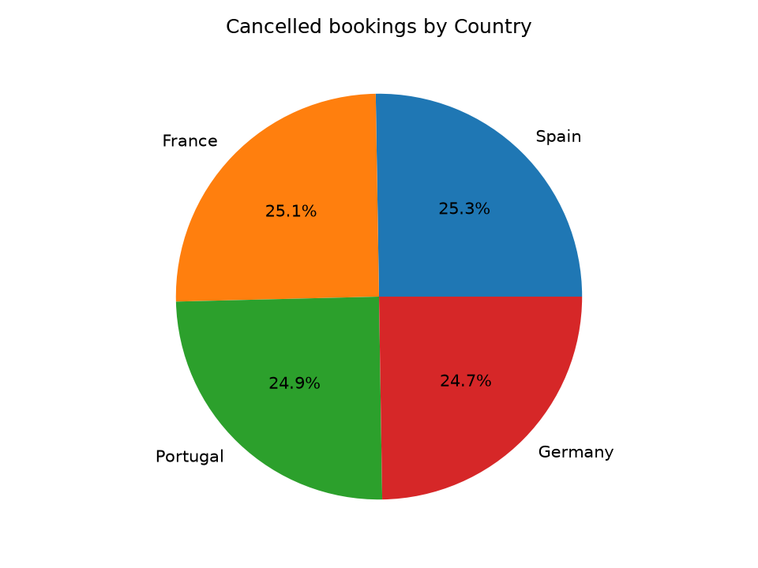

# Hotel Booking Cancellation Analysis 
## Problem Statement
Hotel Ki Sbse Jayda Bookings Cancel ho rahi hai, jisse revenue ka loss hota hai.
Is this project , maine Cancellation ke patterns aur revenue Loss Analyse kiye.

## dataset 
- 10,000 bookings .28 columns (LeadTime, ADR, DepositType, Country, MarketSegment, etc.)
- Cleaning ke baad 9,770 rows (230 invalid negative LeadTime rows hataye)

## Research Questions 
1. How many bookings were cancelled, and how much revenue was lost?
2. Do factors such as the month, deposit type, country, market segment, or lead time affect cancellations?
3. Are cancellation rates higher when prices are higher or when there is a long waiting list?

## Tools 
Python, pandas, matplotlib, seaborn 
Os for save image 

## Steps 
1. Data load aur exploration (missing values, duplicates, data types)
2. Cleaning: invalid LeadTime hataya, IsCanceled ko 1/0 banaya
3. Feature engineering: TotalNights, Revenue, LeadTimeGroup, ADRGroup
4. Analysis: month, deposit type, customer type, market segment, country, lead time
5. Hypothesis testing aur correlation analysis

## Key Findings
- Cancellation rate: 90.16%
- Busiest month: May (892 bookings), slowest: February (749)
- Revenue lost to cancellations: 4,424,323 (90.41% of potential revenue)
- Cancellation rate month, deposit type, customer type, market segment, country aur lead time, sab mein 88-92% ke beech rahi
- Cancel hui aur na hui bookings ka average ADR lagbhag same (99.86 vs 98.86)
- Dono hypotheses (zyada price, lambi waiting list) ko data ka strong support nahi mila
- Koi numeric column cancellation se strongly correlated nahi (sab -0.02 se +0.02)

## Charts 

### Cancellation by Deposit Type

### Cancellation by Month

### Bookings by Month

### Cancellation by Lead Time

### Bookings by Market Segment

### Correlation Heatmap

### Average ADR by Month

### Cancelled Bookings by Country

## Inspiration
I followed the structure of a YouTube tutorial on end-to-end data analysis projects. I wrote the code and did the analysis myself on my own dataset.

## Limitations
- The cancellation rate in this dataset is about 90%, which is much higher than what real hotels usually see.
- No factor (month, deposit type, country, lead time, price) showed a clear link with cancellations. All groups stayed between 88% and 92%.
- The dataset has no hotel type (City/Resort) or booking date columns, so I could not compare hotels or look at trends over time.
- Some groups are small (for example, only 174 bookings had a waiting list of4 to 7 days), so those numbers are not reliable.